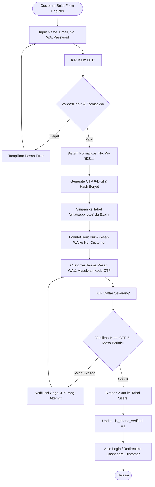
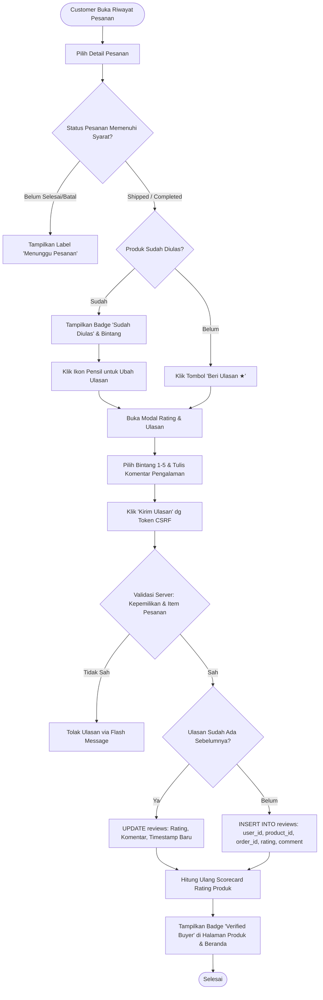
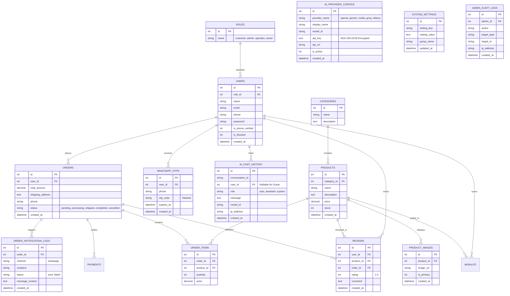

# Product Requirements Document (PRD) v2.0
**Project Name:** NNACOSA (Sistem E-Commerce Perhiasan & Aksesoris Eksklusif Berbasis PHP Native MVC + Multi-Provider AI)  
**Document Version:** 2.0 (Updated & 100% Aligned with Implemented System)  
**Tanggal Diperbarui:** 25 Oktober 2026  
**Status:** Approved & Implemented  

---

## 1. Project Overview

**NNACOSA** (`nnco_sa`) adalah platform e-commerce dan sistem manajemen butik perhiasan serta aksesoris eksklusif (*handmade*) yang dirancang khusus untuk memadukan estetika mewah (*Adelina Soft Luxury*), alur belanja interaktif, kecerdasan buatan (*Multi-Provider AI*), dan komunikasi pelanggan *real-time* via WhatsApp Gateway.

Sistem dibangun menggunakan arsitektur **PHP Native Custom MVC** tanpa dependensi framework besar seperti Laravel, menjamin performa tinggi, efisiensi konsumsi memori di lingkungan localhost/XAMPP maupun VPS Linux, serta kendali penuh atas keamanan data.

### Tujuan Bisnis Utama
1. **Diferensiasi Butik Perhiasan Mewah:** Memberikan impresi visual berkelas tinggi (*soft luxury*, *champagne gold*, *warm ivory*) yang meningkatkan kepercayaan pembeli (*trust & prestige*).
2. **Kecerdasan Buatan Multi-Provider:** Memberikan asisten belanja cerdas 24/7 dan analitik prediksi penjualan yang fleksibel memilih provider AI (OpenAI, Google Gemini, NVIDIA NIM, Groq, hingga Ollama Lokal) tanpa perubahan kode sumber.
3. **Komunikasi & Autentikasi Eksklusif WhatsApp:** Mengurangi ketergantungan pada email yang lambat dan rawan spam dengan mengalihkan 100% alur autentikasi (OTP) serta notifikasi pesanan ke WhatsApp melalui Fonnte API Gateway.
4. **Reputasi Terverifikasi (*Verified Reviews*):** Membangun loyalitas melalui ulasan dan rating bintang 1–5 yang terikat langsung dengan riwayat pesanan sah (*anti-fake reviews*).
5. **Keamanan Data & Kendali Penuh:** Perlindungan kunci rahasia (*API keys*) menggunakan enkripsi terotentikasi AES-256-GCM (*Secret Vault*), pencegahan serangan SSRF (*Server-Side Request Forgery*), proteksi CSRF, dan RBAC (*Role-Based Access Control*) yang ketat.

---

## 2. Technology Stack & System Architecture

### 2.1. Arsitektur Inti
* **Backend:** PHP Native (PHP 8.2+) dengan arsitektur **Custom MVC**:
  * `app/core/App.php`: Routing URL berbasis pola `/{controller}/{action}/{params}`.
  * `app/core/Controller.php`: Base Controller dengan loader view dan model.
  * `app/core/Database.php`: PDO Database Wrapper dengan *prepared statements* dan *parameter binding*.
  * `app/core/Model.php`: Base Model wrapper.
  * `app/core/Security.php`: Sanitasi XSS, CSRF token generator & verifier, validasi URL outbound (SSRF prevention).
  * `app/core/SecretVault.php`: Enkripsi & dekripsi simetris terotentikasi berstandar industri (**AES-256-GCM**).
  * `app/core/RoleMiddleware.php` & `AuthMiddleware.php`: Penegakan otorisasi RBAC dan autentikasi sesi.
* **Database:** MySQL 8.0+ / MariaDB 10.4+ (Database: `nnaco_sa`, 24 tabel relasional InnoDB, UTF8MB4).
* **Frontend:**
  * HTML5 Semantik & Vanilla CSS3 dengan Palet Token *Adelina Soft Luxury* (Warm Ivory `#FFFDF9`, Deep Brown `#4B3B32`, Champagne Gold `#D8BFA3`, Sage Green `#477A5B`).
  * Bootstrap 5.3 (CSS & JS Bundle) untuk tata letak grid responsif dan komponen modal/dropdown.
  * Bootstrap Icons 1.10 & AOS (Animate On Scroll) Library.
  * Google Fonts: **Cormorant Garamond** (Heading) & **Outfit** (Body text).
* **Integrasi Eksternal:**
  * **WhatsApp API Gateway:** Fonnte API untuk OTP 6-digit pendaftaran dan notifikasi perubahan status pesanan.
  * **Multi-Provider AI Service:** Dinamis (*dynamic adapter*) mendukung OpenAI API, Google Gemini (via format OpenAI/Native), NVIDIA NIM (Llama 3/Mistral), Groq, OpenRouter, dan Ollama (Local AI).
  * **PDF Generation:** Ekspor invoice pesanan resmi untuk pencetakan label dan kuitansi.

```mermaid
graph TD
    subgraph Client Layer
        Browser[Web Browser / Mobile Viewport]
    end

    subgraph Presentation & Controller Layer
        Router[App Router - App.php]
        AuthMid[Auth & RoleMiddleware]
        CSRF[CSRF & Security Guard]
        Controllers[Controllers: Home, Catalog, Order, Review, Chatbot, Settings, Ai, User, Product]
        Views[Views: Adelina Soft Luxury Blade/PHP Templates]
    end

    subgraph Service & Security Layer
        AiService[AiService - Dynamic Engine Resolver]
        SecretVault[SecretVault - AES-256-GCM]
        OtpService[OtpService - WhatsApp Multi-Channel]
        NotifService[OrderNotificationService]
    end

    subgraph Data Layer
        Models[Models: Review, Product, User, Order, AiProviderConfig, SystemSetting, etc.]
        DB[(MySQL 8.0 Database - 24 Tables)]
    end

    subgraph External Gateways
        FonnteAPI[Fonnte WhatsApp Gateway]
        AiGateways[OpenAI / Gemini / NVIDIA NIM / Groq / Ollama]
    end

    Browser -->|HTTP Requests| Router
    Router --> AuthMid
    AuthMid --> CSRF
    CSRF --> Controllers
    Controllers --> Views
    Controllers --> Models
    Controllers --> Service Layer
    AiService --> SecretVault
    AiService -->|Validated Outbound HTTP| AiGateways
    OtpService --> FonnteAPI
    NotifService --> FonnteAPI
    Models --> DB
```

---

## 3. Matriks Peran Pengguna (User Roles & Permissions)

Sistem menerapkan **Role-Based Access Control (RBAC)** berbasis tabel `roles`:

| Hak Akses / Fitur | Customer (Role 1) | Admin (Role 2) | Operator (Role 3) | Owner (Role 4) |
|---|:---:|:---:|:---:|:---:|
| **Katalog, Wishlist & Detail Produk** |  |  |  |  |
| **Keranjang & Checkout Pesanan** |  |  |  |  |
| **Riwayat Pesanan & Invoice PDF** |  (Milik Sendiri) |  (Semua) |  (Semua) |  (Semua) |
| **Kirim Rating & Ulasan Produk** |  (Order Terverifikasi) | - | - | - |
| **Moderasi & Hapus Ulasan** |  (Ulasan Sendiri) |  |  |  |
| **AI Floating Chatbot Customer** |  |  |  |  |
| **Admin Chatbot Conversation History** | - |  | - |  |
| **Manajemen Produk & Kategori (CRUD)** | - |  |  | - |
| **Manajemen Pengguna (User & Roles)** | - |  | - |  |
| **Pengaturan Sistem (AI Provider, OTP, Vault)** | - |  | - |  |
| **Executive Dashboard & AI Predictions** | - | - | - |  |

---

## 4. Functional Requirements

### 4.1. Antarmuka Pelanggan (Customer Experience)
1. **Autentikasi & WhatsApp OTP:**
   * Registrasi akun mewajibkan nama, email unik, dan nomor WhatsApp.
   * Sistem menormalisasi format nomor telepon ke standar internasional (`628...`).
   * Pengiriman kode OTP 6-digit via WhatsApp Fonnte Gateway dengan masa berlaku (*expiry*) dan batas percobaan (*max attempts*).
   * Password dienkripsi dengan standar industri `password_hash()` (Bcrypt).
2. **Katalog Eksklusif & Pencarian Cerdas:**
   * Grid produk responsif dengan penanda stok menipis (*badge warning*), status habis, dan cuplikan rating pelanggan (misal: `★ 5.0 (4 ulasan)`).
   * Filter kategori (Kalung, Cincin, Gelang, Anting, Kado) dan pencarian kata kunci *real-time*.
   * Sistem Wishlist interaktif dengan ikon hati responsif.
3. **Halaman Detail Produk Berkelas Tinggi:**
   * Galeri foto produk beresolusi tinggi dengan *badges* jaminan mutu (*100% Asli Handmade, Garansi Kualitas, Kotak Kado Eksklusif*).
   * *Scorecard Rating*: Skor rata-rata bintang, progress bar sebaran bintang 1 hingga 5, dan daftar ulasan pembeli berstatus **Verified Buyer**.
   * Pemicu ulasan interaktif jika pembeli telah memiliki pesanan produk tersebut.
4. **Keranjang & Checkout Pembelian:**
   * Pengelolaan kuantitas item, kalkulasi subtotal, dan input alamat pengiriman.
   * Konfirmasi pembayaran langsung (Cash / Transfer) dengan kode transaksi unik.
5. **Riwayat Pesanan & Rating Ulasan:**
   * Pelacakan status pengiriman (*pending*, *processing*, *shipped*, *delivered/completed*, *cancelled*).
   * Kolom **Ulasan & Rating** pada detail pesanan: Tombol **Beri Ulasan ★** membuka modal interaktif bintang 1–5 dengan label deskriptif dan input komentar kepuasan.
   * Tombol cetak **Invoice PDF** resmi untuk bukti pembayaran.
6. **AI Assistant Widget (Customer Front):**
   * Floating chat widget interaktif 24/7 untuk menjawab pertanyaan seputar koleksi aksesoris, rekomendasi ukuran cincin, bahan titanium/resin, dan panduan belanja.
   * Dukungan percakapan bagi pengguna terdaftar maupun pengunjung anonim (*session-based*).

---

### 4.2. Back-Office Admin & Operator Portal
1. **Dashboard Staf & Admin (`/dashboard`):**
   * Kartu metrik cepat: Pesanan Masuk, Kelola Produk, Ulasan Pelanggan, Riwayat Chatbot, Manajemen User, Pengaturan Sistem.
2. **Manajemen Produk & Foto (`/product`):**
   * CRUD data perhiasan lengkap dengan kategori, harga, stok, dan deskripsi.
   * Pengunggahan foto produk dengan relasi ke tabel `product_images` (`is_primary = 1`).
3. **Manajemen Pesanan & Notifikasi WhatsApp (`/adminorder`):**
   * Verifikasi pesanan, update status pengiriman (*Processing, Shipped, Delivered*), dan input nomor resi.
   * **Otomasi Notifikasi WhatsApp:** Setiap perubahan status pesanan otomatis memicu pesan WhatsApp personal ke nomor pembeli melalui Fonnte Gateway (notifikasi email dinonaktifkan).
4. **Moderasi Ulasan Pelanggan (`/review/admin`):**
   * Tabel daftar ulasan masuk menampilkan avatar pembeli, nama perhiasan, jumlah bintang, teks ulasan, dan tanggal transaksi.
   * Filter pencarian kata kunci dan filter perolehan bintang (1 sampai 5 bintang).
   * Tombol aksi hapus ulasan tidak pantas dengan proteksi token CSRF.
5. **Admin Chatbot Conversation History (`/chatbot`):**
   * Kemampuan membaca seluruh transkrip dialog antara chatbot AI dan customer.
   * Pemisahan riwayat pengunjung anonim (*guest*) dan pelanggan terdaftar.
   * Filter percakapan berdasarkan ID sesi, kata kunci pesan, dan rentang tanggal.
   * Audit log admin (`admin_audit_logs`) mencatat aktivitas peninjauan percakapan tanpa melanggar privasi teks sensitif.
6. **Manajemen Pengguna (`/user`):**
   * Pengelolaan akun pelanggan dan akun staf internal.
   * Penugasan role (Admin, Operator, Owner, Customer).
   * Penguncian/pemblokiran akun bermasalah dan reset password aman.

---

### 4.3. Pengaturan Sistem & Secret Vault (`/settings`)
1. **Konfigurasi Multi-Provider AI (`/settings/ai`):**
   * Manajemen penyedia AI (OpenAI, Google Gemini, NVIDIA NIM, Groq, Ollama).
   * Penentuan provider aktif (*active engine switch*) secara instan.
   * Fitur **Uji Koneksi Provider (*Health Check*)** langsung dari antarmuka admin.
2. **Secret Vault (AES-256-GCM):**
   * Seluruh API Key dan rahasia kredensial dienkripsi dengan *Authenticated Encryption* di database.
   * Tampilan kunci rahasia pada form secara otomatis disamarkan (*masked* dengan bullet `••••`).
   * Fitur retensi kunci: Jika form disimpan tanpa mengisi ulang API Key, sistem mempertahankan kunci terenkripsi yang sudah ada.
3. **Konfigurasi Gateway WhatsApp Fonnte (`/settings/auth`):**
   * Pengelolaan Fonnte API Token dan nomor pengirim WhatsApp.
   * Penyesuaian kebijakan OTP: Panjang digit (default 6 digit), durasi kedaluwarsa (detik), batas percobaan (*max attempts*), dan jeda pengiriman ulang (*cooldown*).
   * Konfirmasi non-aktif layanan Email SMTP demi kepastian alur tunggal WhatsApp.

---

### 4.4. Executive Owner Dashboard (`/ai`)
1. **AI Sales Forecasting & Predictive Analytics:**
   * Analisis tren penjualan berbasis data historis transaksi.
   * Estimasi volume pesanan dan proyeksi pendapatan periode mendatang.
2. **Behavioral Insights:**
   * Laporan produk terlaris (*best seller*), produk minim peminat (*slow moving*), dan rangkuman kepuasan ulasan pelanggan.

---

## 5. Security Architecture & Non-Functional Requirements

### 5.1. Spesifikasi Keamanan Data
* **Secret Vault (AES-256-GCM):** Kunci rahasia API disimpan dalam format base64 yang memuat *Initialization Vector* (IV) 96-bit, *Ciphertext*, dan *Authentication Tag* 128-bit untuk mencegah manipulasi data *at rest*.
* **SSRF Prevention (`Security::validateOutboundUrl`):** Setiap URL endpoint yang dikonfigurasi pada sistem diverifikasi secara ketat untuk memblokir alamat IP lokal (`127.0.0.1`, `localhost`), IP privat RFC 1918 (`10.0.0.0/8`, `172.16.0.0/12`, `192.168.0.0/16`), Cloud Metadata Services (`169.254.169.254`), dan domain internal.
* **Proteksi CSRF (Cross-Site Request Forgery):** Seluruh formulir POST (checkout, ulasan, pengaturan, ganti status) dilindungi token kriptografis unik `Security::generateCsrfToken()`.
* **Proteksi XSS & SQL Injection:** Seluruh input pengguna disanitasi menggunakan `Security::escape()` dan dieksekusi dengan PDO *Prepared Statements* berparameter.
* **Otorisasi Kepemilikan Pesanan & Ulasan:** Pelanggan hanya diizinkan mengulas produk yang tercantum dalam pesanan miliknya sendiri yang sudah berstatus sah.

### 5.2. Kinerja & Ketersediaan
* **Waktu Respons Halaman:** < 1.5 detik pada lingkungan localhost dan server standar.
* **Optimasi Query SQL:** Menggunakan kueri agregasi batch (`getAverageRatingsForProducts`) untuk mencegah masalah *N+1 query* saat memuat katalog produk.
* **Skalabilitas AI Provider:** Jika satu penyedia AI mengalami *downtime* atau kehabisan kuota, Admin dapat berpindah ke penyedia lain dalam 1 klik tanpa *re-deploy* aplikasi.

---

## 6. Use Case Diagram

```mermaid
usecaseDiagram
    actor Customer as "Customer"
    actor Admin as "Admin"
    actor Operator as "Operator"
    actor Owner as "Owner"

    %% Customer Use Cases
    usecase UC_Reg as "Daftar & Verifikasi WhatsApp OTP"
    usecase UC_Cat as "Lihat Katalog, Detail & Wishlist"
    usecase UC_Order as "Checkout & Konfirmasi Bayar"
    usecase UC_Review as "Beri Rating & Ulasan Bintang 1-5"
    usecase UC_Chat as "Konsultasi via AI Floating Chatbot"

    %% Admin & Operator Use Cases
    usecase UC_Prod as "Kelola Produk & Galeri Foto"
    usecase UC_OrderStatus as "Update Status & Kirim Notif WA"
    usecase UC_RevMod as "Moderasi & Hapus Ulasan"
    usecase UC_ChatHist as "Pantau Riwayat Percakapan Chatbot"
    usecase UC_UserMgmt as "Manajemen Akun User & Role"
    usecase UC_SysSet as "Konfigurasi AI Provider & Secret Vault"

    %% Owner Use Cases
    usecase UC_Analytics as "Analitik Prediksi AI & Dashboard Bisnis"

    Customer --> UC_Reg
    Customer --> UC_Cat
    Customer --> UC_Order
    Customer --> UC_Review
    Customer --> UC_Chat

    Operator --> UC_Prod
    Operator --> UC_OrderStatus
    Operator --> UC_RevMod

    Admin --> UC_Prod
    Admin --> UC_OrderStatus
    Admin --> UC_RevMod
    Admin --> UC_ChatHist
    Admin --> UC_UserMgmt
    Admin --> UC_SysSet

    Owner --> UC_RevMod
    Owner --> UC_ChatHist
    Owner --> UC_UserMgmt
    Owner --> UC_SysSet
    Owner --> UC_Analytics
```

---

## 7. Activity Diagrams

### 7.1. Alur Pendaftaran & Verifikasi WhatsApp OTP


### 7.2. Alur Pengiriman Rating & Ulasan Pelanggan


---

## 8. Database Architecture & ERD (24 Tables)

Struktur database relasional MySQL `nnaco_sa` terdiri dari 24 tabel terintegrasi penuh:



---

## 9. Struktur Tabel Utama (Data Dictionary)

### 9.1. Tabel `reviews`
| Kolom | Tipe Data | Constraint | Keterangan |
|---|---|---|---|
| `id` | INT | PK, Auto Increment | ID unik ulasan |
| `user_id` | INT | FK -> `users(id)`, ON DELETE CASCADE | ID pelanggan penulis ulasan |
| `product_id` | INT | FK -> `products(id)`, ON DELETE CASCADE | ID perhiasan yang diulas |
| `order_id` | INT | FK -> `orders(id)`, ON DELETE CASCADE | ID pesanan yang memverifikasi transaksi |
| `rating` | INT | CHECK (`rating >= 1 AND rating <= 5`) | Nilai kepuasan (1 sampai 5 bintang) |
| `comment` | TEXT | Nullable | Ulasan tekstual pengalaman pembeli |
| `created_at` | TIMESTAMP | DEFAULT CURRENT_TIMESTAMP | Waktu ulasan dikirim/diperbarui |

### 9.2. Tabel `ai_provider_configs`
| Kolom | Tipe Data | Constraint | Keterangan |
|---|---|---|---|
| `id` | INT | PK, Auto Increment | ID konfigurasi provider |
| `provider_name`| VARCHAR(50) | Not Null | Identifier provider (`openai`, `gemini`, `nvidia`, dll.) |
| `display_name` | VARCHAR(100)| Not Null | Nama label tampilan di dashboard admin |
| `model_id` | VARCHAR(100)| Not Null | Identifier model LLM (misal: `gpt-4o-mini`, `gemini-1.5-flash`) |
| `api_key` | TEXT | Nullable | Ciphertext kunci API rahasia (AES-256-GCM) |
| `api_url` | VARCHAR(255)| Nullable | Base endpoint URL provider |
| `is_active` | TINYINT(1) | DEFAULT 0 | Penanda provider aktif (1 = aktif digunakan sistem) |
| `created_at` | TIMESTAMP | DEFAULT CURRENT_TIMESTAMP | Tanggal pembuatan konfigurasi |

### 9.3. Tabel `ai_chat_history`
| Kolom | Tipe Data | Constraint | Keterangan |
|---|---|---|---|
| `id` | INT | PK, Auto Increment | ID pesan obrolan |
| `conversation_id`| VARCHAR(100)| Index, Not Null | Token unik pengelompok sesi dialog multi-turn |
| `user_id` | INT | FK -> `users(id)`, Nullable | ID customer (NULL jika pengunjung anonim) |
| `role` | VARCHAR(20) | 'user', 'assistant', 'system' | Pengirim giliran percakapan (*turn*) |
| `message` | TEXT | Not Null | Konten pesan dialog |
| `model_id` | VARCHAR(100)| Nullable | Model AI yang memproses respons |
| `ip_address` | VARCHAR(45) | Nullable | Alamat IP klien untuk audit dan keamanan |
| `created_at` | TIMESTAMP | DEFAULT CURRENT_TIMESTAMP | Waktu pertukaran pesan |

---

## 10. Daftar Rute Controller & Endpoints

| URI Route | Method | Controller & Action | Hak Akses (RBAC) | Fungsi Utama |
|---|---|---|---|---|
| `/` | GET | `HomeController@index` | Publik | Halaman Beranda dengan koleksi terbaru & ulasan unggulan |
| `/catalog` | GET | `CatalogController@index` | Publik | Katalog perhiasan dengan filter kategori, pencarian & rating batch |
| `/catalog/detail/{id}` | GET | `CatalogController@detail` | Publik | Detail perhiasan, scorecard rating bintang & ulasan pembeli sah |
| `/cart` | GET | `CartController@index` | Customer | Halaman keranjang belanja |
| `/order` | GET | `OrderController@index` | Customer | Riwayat daftar pesanan pelanggan |
| `/order/detail/{id}` | GET | `OrderController@detail` | Customer | Detail rincian pesanan & pemicu form modal ulasan produk |
| `/order/invoice/{id}` | GET | `OrderController@invoice` | Customer, Admin | Cetak invoice PDF resmi pesanan |
| `/review/submit` | POST | `ReviewController@submit` | Customer | Endpoint submit/update ulasan dan rating bintang 1-5 |
| `/review/admin` | GET | `ReviewController@admin` | Admin, Operator, Owner | Panel moderasi ulasan pelanggan dengan pencarian & filter bintang |
| `/review/delete/{id}` | POST | `ReviewController@delete` | Customer, Admin | Hapus ulasan dengan proteksi hak akses dan CSRF token |
| `/dashboard` | GET | `DashboardController@index`| Admin, Operator, Owner | Portal admin dengan tombol akses cepat seluruh menu operasional |
| `/adminorder` | GET/POST | `AdminorderController@...` | Admin, Operator | Pengelolaan pesanan masuk & kirim notifikasi WhatsApp |
| `/chatbot` | GET | `ChatbotController@index` | Admin, Owner | Panel riwayat percakapan chatbot pengunjung & customer |
| `/chatbot/detail/{id}` | GET | `ChatbotController@detail` | Admin, Owner | Baca transkrip dialog lengkap satu sesi percakapan |
| `/settings/ai` | GET/POST | `SettingsController@ai` | Admin, Owner | Konfigurasi AI Provider, ganti model, uji koneksi & Secret Vault |
| `/settings/auth` | GET/POST | `SettingsController@auth` | Admin, Owner | Pengaturan WhatsApp Fonnte token dan kebijakan keamanan OTP |
| `/user` | GET/POST | `UserController@...` | Admin, Owner | Manajemen data user, peran staf, dan reset password |
| `/ai` | GET | `AiController@index` | Owner, Admin | Executive Dashboard analitik prediksi penjualan berbasis AI |

---

## 11. Strategi Pengujian & Suite Uji Otomatis

Sistem dilengkapi dengan **Suite Pengujian Otomatis (*Automated Test Suites*)** berbasis CLI PHP di folder `tests/`:

1. **`test_customer_reviews.php` (13 Pengujian):**
   * Validasi simpan ulasan baru rating 1–5 dan komentar.
   * Penolakan ulasan dari pengguna yang tidak pernah membeli produk terkait.
   * Idempotensi pembaruan ulasan tanpa duplikasi record database.
   * Kalkulasi akurasi rata-rata bintang dan distribusi sebaran 1–5 pada *Product Rating Summary*.
   * Ekstraksi *batch ratings* untuk efisiensi kueri halaman katalog.
   * Filter pencarian kata kunci dan filter bintang admin.
   * Proteksi otorisasi penghapusan ulasan dan jaminan *cleanup* otomatis via blok `try ... finally`.
2. **`test_system_settings.php` (38 Pengujian):**
   * Pengujian enkripsi & dekripsi terotentikasi **AES-256-GCM** pada Secret Vault.
   * Penolakan manipulasi ciphertext melalui verifikasi GCM Authentication Tag.
   * Validasi penangkalan SSRF terhadap IP lokal, IP privat, dan metadata AWS/Cloud.
   * Pengujian retensi rahasia (API key tetap aman saat form diupdate tanpa mengubah key).
   * Alur hashing bcrypt OTP, pembatasan *cooldown*, dan perlindungan serangan *replay*.
3. **`test_chatbot_history.php` (24 Pengujian):**
   * Persistensi giliran percakapan (*turn persistence*) dan deduplikasi pesan.
   * Penanganan obrolan pengunjung anonim vs pelanggan terdaftar.
   * Sanitasi XSS pada riwayat pesan dan perlindungan kerahasiaan API Key pada metadata.
   * Pencatatan riwayat audit admin (`admin_audit_logs`).
4. **`test_user_management.php` (16 Pengujian):**
   * Pengujian alur CRUD pengguna dan pembaruan peran (*role promotion*).
   * Verifikasi keunikan email dan nomor telepon.
   * Hashing password dengan Bcrypt.
5. **`test_register_whatsapp_otp.php` (17 Pengujian):**
   * Pengujian normalisasi nomor telepon ke format internasional `628...`.
   * Permintaan kode OTP 6-digit via Fonnte Gateway.
   * Verifikasi kode OTP benar vs penolakan kode OTP keliru.
6. **`test_order_whatsapp_only.php` (13 Pengujian):**
   * Verifikasi pengiriman notifikasi pembaruan status pesanan ke nomor WhatsApp pembeli.
   * Penegasan penonaktifan pengiriman email notifikasi.

---

## 12. Panduan Pemeliharaan & Pengembangan Selanjutnya

1. **Penyimpanan Kunci Rahasia:** Jangan pernah mengubah `SECRET_VAULT_KEY` yang tersimpan di lingkungan tanpa melakukan re-enkripsi data pada tabel `ai_provider_configs` dan `auth_provider_configs`.
2. **Pembersihan Data Pengujian:** Seluruh skrip pengujian baru di masa mendatang wajib menerapkan pola penanganan `try { ... } finally { ... }` untuk memastikan integritas data katalog publik tidak tercemar oleh data dummy tes.
3. **Penambahan Provider AI Baru:** Pengembang dapat menambahkan provider baru dengan mengimplementasikan antarmuka pada `app/services/ai/` dan mendaftarkannya pada `AiService.php` tanpa perlu mengubah antarmuka pengguna.

---
*Dokumen PRD v2.0 ini adalah acuan spesifikasi resmi yang merepresentasikan 100% arsitektur, basis data, dan fitur yang aktif pada platform NNACOSA.*

